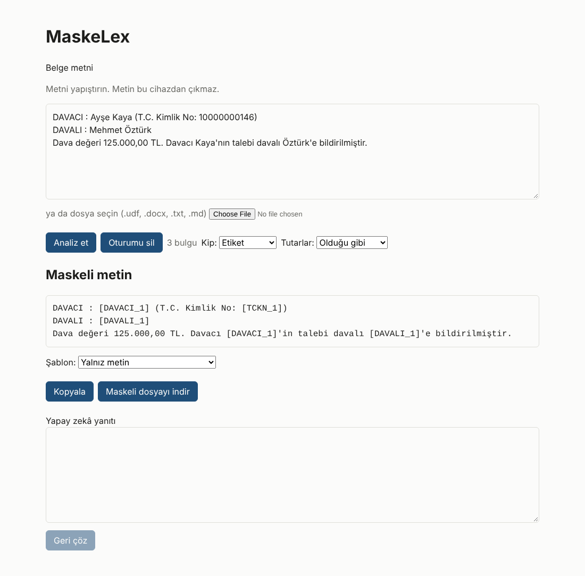

# MaskeLex

**Hukuki belgelerdeki kişisel verileri yapay zekâya göndermeden önce kendi cihazınızda maskeleyin, yanıtı yine cihazınızda geri çözün.**

**Hemen kullanın:** https://tialkan.github.io/maskelex/ (kayıt yok, sunucu yok, ücretsiz)



## Ne yapar

1. **Maskele.** Metni yapıştırın ya da `.udf`, `.docx`, `.txt` dosyası seçin. Kişiler role göre (`[DAVACI_1]`, `[VEKİL_1]`),
   T.C. kimlik, VKN, MERSİS, IBAN, kart, telefon, e-posta, plaka, dosya numarası türüne göre etiketlenir. Sağlama gerektiren
   numaralar algoritmik olarak doğrulanır. Yargıtay, Danıştay ve bölge mahkemesi künyeleri ile kanun atıfları korunur.
2. **Kopyala.** Maskelenmemiş bir bilgi kalırsa sızıntı denetimi kopyalamayı kilitler; bulguyu bir kişiye bağlar ya da
   bilerek onaylarsınız. Hazır hukuki prompt şablonları (dilekçe, cevap, sözleşme incelemesi, özet) vardır.
3. **Geri çöz.** Yapay zekânın yanıtını yapıştırın; etiketler gerçek bilgilerle yerine konur ve Türkçe ekler gerçek ada göre
   düzeltilir (`[DAVACI_1]'e` → `Ayşe Kaya'ya`). Sonucu UDF ya da Word olarak indirin.

Ek seçenekler: **Fonetik İkiz** (etiket yerine sesçe uyumlu sahte ad: `《Nusret Özkan》`) ve **tutar ölçekleme**
(bütün tutarlar aynı gizli oranla çarpılır, oranlar korunur).

## Gizlilik

- Sunucu tarafı kod yoktur; işlem tarayıcıdaki bir Web Worker'da yapılır.
- Sıkı içerik güvenlik politikası ve ağ denetçisi dış bağlantıyı engeller; her sürümde Playwright testi
  "uygulama kökeni dışına sıfır istek" koşulunu doğrular (`e2e/security.ts`).
- Etiket eşleşmeleri yalnız bellekte tutulur; isteğe bağlı olarak PBKDF2 (600.000 tur) + AES-256-GCM ile şifreli dosyaya
  aktarılır.
- Maskeli Word dosyası sıfırdan üretilir (yazar, yorum, izlenen değişiklik taşınmaz); UDF'den e-imza ve UYAP doğrulama
  bilgisi çıkarılır.

**Sınırlar:** Otomatik tespit kusursuz değildir; kopyalamadan önce gözden geçirin. Olay ayrıntıları maskelenmez. Tarayıcı
eklentileri sayfa metnini okuyabilir. Bu araç hukuki danışmanlık vermez.

## Geliştirme

```bash
pnpm install
pnpm test:acceptance      # kabul testleri
pnpm test:e2e             # güvenlik testleri (Playwright)
pnpm --filter @maskelex/web dev
```

| Klasör | İçerik |
|---|---|
| `packages/core-engine` | Tespit, maskeleme, geri çözme, kasa, NER hattı |
| `packages/document-parsers` | UDF, DOCX, düz metin codec'leri |
| `apps/web` | Web uygulaması ve tanıtım sayfası |
| `apps/desktop-tauri` | Masaüstü kabuğu (Tauri v2) |

Tasarım belgesi: [`MASTER.md`](MASTER.md). Mimari kararlar: [`docs/adr`](docs/adr).

## Lisans

[GNU AGPL-3.0](LICENSE). Kodu değiştirip bir ağ hizmeti olarak sunanlar değiştirilmiş kaynak kodunu da paylaşmak zorundadır.
Ad sözlükleri `@faker-js/faker` (MIT) verisinden üretilmiştir (`packages/core-engine/src/names/data/KAYNAK.md`).
